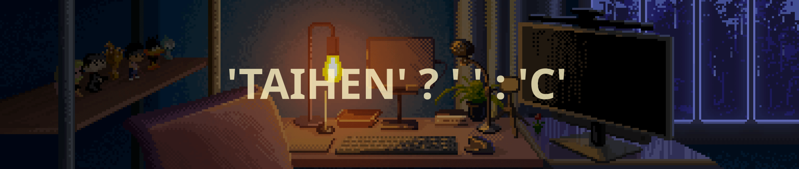
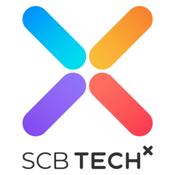

  

<!--  -->

# Hi there! 👋 I'm `Atom`

🎓 Final-year Computer Engineering and Digital Technology student at Chulalongkorn University (GPAX 3.85)

🗼 Research Intern at The University of Tokyo · 💻 Software Engineer · 🤖 AI/ML Engineer

## About Me

&nbsp;&nbsp;&nbsp; Very passionate about developing and coding, I began coding since high school. I devoted so much time to coding so I lost my Pro-league-like reflexes(shooting games),had no time to catch up on new game patches, and barely touched grass.by sacrificing those things, what I got in return is coding skills and a nice part-time job.

-   😉 **Tech Enthusiast:** Self-Hosted Home Server (Linux, Containers, Networking, IaC)
-   😫 **Hobbies**: Anime, Manga, Coding, ~~Video Games~~ (Still play, but much less compared to the past)

## Open Source Contribution

-    **[Tachiyomi](https://github.com/tachiyomiorg) Contributor** (sadly it archived)

## Experience

-    **The University of Tokyo:** Research Intern, Oguchi Lab, IIS (Jun 2026 - Nov 2026) Sim-to-real calibration of multi-agent traffic models. First-author paper submitted to ITS Symposium 2026.
-    **SCB TechX:** Technical Lead / Project Manager, Capstone Intern (Sep 2025 - May 2026) Led 5 devs building an internal RAG knowledge system.
-    **Skooldio:** AI Engineer, Part-time (Aug - Dec 2025) · Full Stack Developer, Intern (Jun - Jul 2025)
-    **Profluid GmbH:** Junior / Full Stack Developer - Part-time (remote) (Sep 2024 - May 2026)
-    **LINE MAN Wongnai:** Software Engineer Intern, Android (May - Jul 2024)
-   🎓 **Chulalongkorn University:** Teaching Assistant (Aug 2024 - Dec 2025) · ISD SGCU Senior Frontend Developer (Jul 2024 - May 2025)

## Projects

-   [YAKINIKU](https://github.com/Taihenc/YAKINIKU/) (🌐 Web-Dev) Group project of 4, but I'm the sole front/back-end developer.
-   [RealTime-Leaderboard](https://github.com/Taihenc/GO-Real-time-Leaderboard) (⚡ Backend) Real-time leaderboard service using Redis sorted sets (Go, Redis).
-   [StaySleep](https://cedt-se-project-staysleep.vercel.app/) (🏨 Web-Dev) Hotel booking app; led front end, back end and design (Next.js, MongoDB).
-   [MoeKot](https://github.com/Taihenc/MoeKot) (📱 Android) A side project so I become more comfortable with the Android development process.
-   ~~🕹️ **Game Development (Unity):**~~ [Currently private]
-   ~~🏡 **Self-Hosted Home Server:**~~ [Currently private]

## Skills

  
  
  

## Connect with me

Feel free to reach out, whether it's for collaboration, job opportunities, or just chatting! 🚀
